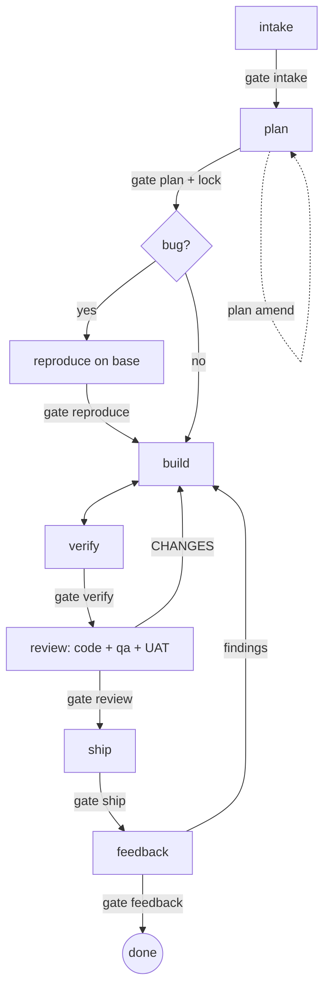
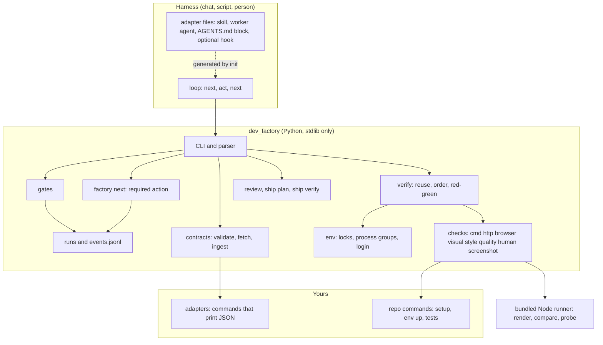

# dev.factory

**Evidence-or-zero delivery: one ticket in, one proven draft change request out.**

dev.factory is a local, harness-agnostic CLI that takes a ticket (or an epic, or a change to review) through intake, plan, build, verify, review and ship. No step passes on a model's claim. Every acceptance criterion needs an executed check, every check result is bound to the commit and the spec it proved, and gates only read that evidence. A chat harness, a script or a person can drive it through one loop: `factory next`, do the action, `factory next`.

> Status: `1.0.0-alpha` (package version `1.0.0a1`). Python 3.11 or later, standard library only. The CLI makes no network calls of its own.

- [Why](#why) · [Architecture](#architecture) · [Requirements](#requirements) · [Install](#install) · [Quick start](#quick-start)
- [Configuration](#configuration) · [Commands](#command-reference) · [Checks](#check-types) · [Contracts and adapters](#contracts-and-adapters) · [Development](#development)

## Why

A cooperative model can still be lazy. It may call an AC done from reading code, count zero executed tests as a pass, loosen a check after the plan, or carry a review past a later commit. Write guards over local files are bypassable by construction, so dev.factory binds evidence instead of guarding writes, and keeps the learning in `LESSONS.md`, one row per real incident.

| Principle | What it means |
|---|---|
| **Evidence-or-zero** | Only `factory verify` writes evidence. A record names the check-spec hash, repo, full SHA and a clean-worktree flag, and a gate accepts it only while those match the current HEAD and the plan lock. |
| **Gates decide** | `factory gate <name>` reads and records pass or fail with every failing reason listed. A green pipeline never proves an AC. |
| **`events.jsonl` is the only state** | There is no `run.json`. Phase, loops, locks and blockers are derived from one append-only file, so concurrent writers cannot lose state. |
| **Contracts, not providers** | Tickets, changes, pipelines and design frames are fixed, validated shapes. Whatever talks to your tracker, SCM or design tool is a small adapter you own. |
| **Remote content is evidence, never instruction** | Payloads go to files, not through chat. A bug gets no fix without a reproduction. |
| **Three pillars** | Tickets (intake, media, questions), design (frames, pixel and computed-style parity) and change requests (ship plan, readback, feedback). |

## Architecture

### Run flow



- **Plan lock.** `gate plan` hashes the plan, every check spec, declared fixtures, the proof-relevant config and the raw contracts. Drift fails every later gate until `factory plan amend --reason "..."`.
- **Loop budget.** `[autonomy] max_loops` (default 5) is one budget for unapproved plan amends and review rounds that carry a blocker or major finding, plus feedback rounds. Rounds that only fix minor findings, and amends that only close them (`--resolves`), are free. When it is spent the command refuses and the run blocks for the user; each recorded user decision allows one more round. Build and verify iterations are free.
- **Reviews.** Fresh reviewers who wrote nothing in the run record a code review and a qa review; a change with a screen also takes a UAT in the browser, by another fresh reviewer who uses the screens logged in through exploration scripts (`factory uat run`). Every finding about the delivery is fixed before ship, minor ones included; a reviewer marks `"scope": "out"` only on what is not part of this delivery.
- **Delivery.** A moved base comes in by rebase (no merge commit); fixes asked on the way are `fixup!` commits folded before ship, so the change carries its feature commits only. Its description is `ship/summary.md`, written for a human reviewer who never sees the run.
- **Exit codes.** 0 ok, 1 a check or gate failed (the reasons are your to-do list), 2 usage, config or lock error, 3 environment failure, 4 the CLI needs the user's input (the JSON on stdout says what: `"need": "ticket"` or `"need": "setup"` with its questions).

### Components



| Part | Role |
|---|---|
| **CLI core** | One module per concern, each capped at 400 lines (`DESIGN.md` section 14). Derives all state from events. |
| **`factory next`** | Prints the one required action: phase, command, why a pending gate would fail, a role hint, and the absolute path of each file it expects. `--json` for machines. |
| **Checks** | Eight types (see [Check types](#check-types)). A wall-clock cap kills the whole process tree; two identical failures stop a batch. |
| **Contracts and adapters** | `ticket`, `change`, `change_list`, `pipeline`, `design_frame`, `design_image`. Acquired by an adapter command, or written by the agent and validated by `factory ingest`. |
| **Harness adapters** | `factory init --harness <id>` writes thin generated files (at most 100 lines each, 3 per harness). Hooks are optional hardening: no gate depends on one. |
| **Node runner** | `browser/` (plain JavaScript). It only renders, compares and probes; Python computes crop boxes and tolerances. The page may reach only the env origin. |

### Project and workspace layout

A workspace normally lives in your home, one folder per workspace; the project repositories are never written to, and deleting a workspace is deleting its folder:

```text
~/.factory/<workspace>/        FACTORY_HOME moves ~/.factory; the folder name is the workspace name (unique)
  factory.toml                 the repos (path and remote_url), commands, env, standing checks, providers, ship, autonomy
  secrets.env                  KEY=value, written by you; never asked in a chat
  setup.json                   the setup questions already asked or skipped
  scripts/  login/             your helper scripts and login specs
  runs/<run-id>/               run state (as below)
  env/  local.toml             env locks and login state; this machine's facts
  worktrees/<run-id>/<repo>/   per-run git worktrees
```

A folder workspace (a `factory.toml` in the repo or in a directory above it) keeps working:

```text
<project>/                     one repo, or a workspace directory holding several
  factory.toml                 versioned: repos, commands, env, standing checks, providers, limits, ship, autonomy
  .factory/                    unversioned (init adds it to .gitignore)
    local.toml                 this machine only: paths, base URLs, worktree_root, port slots
    runs/<run-id>/
      events.jsonl             append-only, the only run state
      raw/  contracts/         untouched payloads and validated contracts
      media/  plan.json  checks/  diagnosis.md  notes/
      artifacts/<check>/<n>/   output, screenshots, diffs of each attempt
      ship/  report/           intents, body, readbacks
    env/                       env locks, process records, login state
<user cache>/dev.factory/worktrees/<project>/<ticket>/<repo>   per-run git worktrees, outside the repo tree
```

- **Single repo:** `factory.toml` at the root with `[[repo]] path = "."`.
- **Workspace:** `[[repo]]` entries point at members (`path = "../api"`). A member's own `factory.toml` is the base and the workspace overrides it key by key. Each repo has its own base branch.
- **Discovery:** `--project DIR`, then `--workspace NAME` (a folder of `~/.factory`), then the climb from the cwd to the first `factory.toml`, then the home workspaces whose `[[repo]]` `path` is this repository's top folder or whose `remote_url` is one of its remotes (`git@host:o/r.git` and `https://host/o/r` are the same; another clone or machine is recognised). Two matches are an ambiguity: a terminal asks which, otherwise pass `--workspace`. It never imports code from the cwd.
- **`local.toml`** may set machine facts only (paths, ports, base URLs, runner path). Any other key is an error, so it cannot loosen proof.
- **Secrets:** `factory.toml` names keys only. Values come from the environment or the workspace's `secrets.env` (a folder workspace reads `~/.config/dev.factory/secrets/<project>.env`), reach children as environment variables, and are redacted from stored output.

### Composite runs

All of these are ordinary runs with their own events, using the same gates, `next`, `verify` and `ship`.

| Run | How it works |
|---|---|
| **Hotfix** (`run start KEY --kind hotfix`) | A bug run on the base. After review, `factory mirror <repo> --to <target>` cherry-picks the fix onto each configured target in its own worktree. `verify --mirror` checks each target; the ship gate needs `factory mirror diff` to show the same fix (or a user decision naming the divergent files). |
| **Epic** (`run start EPIC --kind epic`) | `factory epic plan` computes dependency waves and starts child runs, with stacked branches. `next <epic>` lists up to `[orchestration] max_parallel` ready children. `epic ship plan\|verify` plans the changes in wave order. |
| **Review run** | `factory review queue` lists changes waiting for you; `review start CHANGE...` makes one review run per change (a parent for several). Phases: intake, plan, verify, review, report. `review report` writes neutral comment and approve intents, none automatic; `review fix` turns the run into a ticket run on the change branch. |
| **Parallel sessions** | `factory claim --session <hint>` records who works on a run; `next` from another session refuses without `--takeover`. `env up --slot N` serves a run on its own ports with its own lock. |

## Requirements

| Dependency | Needed for | Notes |
|---|---|---|
| Python 3.11 or later | the CLI | standard library only; no runtime packages |
| `git` | everything | worktrees, branch points, SHAs; the CLI never runs reset, stash, clean or force-push |
| Node 20 or later and a headless browser | `browser`, `visual`, `style`, `screenshot` checks | only when a plan uses them; see `browser/package.json` and `browser/install-command.txt` |
| Your tracker, SCM and design tooling | adapters | optional; without an adapter the agent saves payloads and runs `factory ingest` |
| OS | Windows, Linux, macOS | developed and tested on Windows; the Linux CI job is configured but not yet run; paths with spaces and apostrophes are covered |

## Install

dev.factory is a standard Python application. Install it from a git tag, apart from any working tree, so a branch under edit never serves a live run. Details: [`docs/install.md`](docs/install.md).

```sh
# pick one; <repo-url> is the repository you cloned from
pipx install "git+<repo-url>@1.0.0-alpha"
uv tool install "git+<repo-url>@1.0.0-alpha"
python -m venv ~/.venvs/factory && ~/.venvs/factory/bin/pip install "git+<repo-url>@1.0.0-alpha"   # Windows: Scripts\pip.exe

factory --version        # version, build and the Python it runs
```

- The tag `1.0.0-alpha` installs as version `1.0.0a1` (the PEP 440 spelling).
- Upgrade by installing the new tag again with `--force`. Pin a project to a CLI range with `[project] cli = ">=1.0.0a1,<1.1"`; `factory check` fails outside it.
- **Browser runner (optional).** It is not part of the installed package. From a checkout of the same tag, run the command in `browser/install-command.txt`, then point the machine at it in `.factory/local.toml`:

  ```toml
  [checks.browser]
  bundled = "<checkout>/browser/src/cli.js"
  ```

  `factory check` warns while a plan needs the runner and it is missing. On a fresh Linux image the browser also needs its system libraries (see `docs/install.md`).

## Quick start

### 1. Start in a repository

```sh
cd ~/code/billing-web
factory                                    # or: factory start ABC-123 (a key or a ticket URL)
```

`factory` finds the workspace of the repository and asks for the ticket. With no workspace yet it runs the setup interview first; every step is optional except the workspace and the repo's name and base branch:

```text
Which workspace does this repository belong to? Pick one, or name a new one (lowercase letters, digits and -; one folder in ~/.factory)
  1) billing  existing workspace
  2) billing-web  a new workspace
answer [billing-web]> 1
Name of the repository at ~/code/billing-web in the workspace
answer [billing-web]> web
Base branch of web (changes start from it and target it)
  1) develop
  2) main
answer [main]> develop
Standing checks of web (commands that must pass on every change; or id=command) ['-' skips: asked at every run]
  1) test  node --run test
  2) ci-make-unit  make unit (vars NODE_ENV=test)
numbers or names, comma separated> 1,2
...
workspace billing saved in ~/.factory/billing (repos: api, web)
write these secrets in ~/.factory/billing/secrets.env (KEY=value, never in a chat): TEST_PASSWORD, TEST_USER
asked at every run: repo api: target branches, standing checks
workspace billing: ticket key or URL>
```

The steps: the workspace, this repository (name, base branch; its path and remotes are recorded), per repository the target branches, the env (start command, base URL, health), the test database seed and reset (only when the repo shows a database), the standing checks (from its scripts and CI steps, with their variables), the login spec for browser checks (only for a repo with a UI) and free-text notes for the agent, then the sibling repositories next to it, the integrations that get an adapter command, and the branch and change-request title templates. A skipped setting is asked at every run that needs it.

Without a terminal (an agent) the same interview is JSON: `factory setup --questions --json` prints the pending questions (`id`, `text`, `kind` single / multi / text, `options` with `label` and `description`, `optional`, `default`) and exits 4; `factory setup --answer ID=VALUE [--answer ...]` applies answers (an empty value skips; a multi answer is comma separated or repeated) and prints the next questions or the summary. Both paths write the same `factory.toml`. Change one setting later with `factory config set repo.web.base develop` (checked against the schema; unknown keys are refused). In a run, `factory ask "<question>" --save-as repo.web.env.base_url` and `factory answer Q-n --user-said "<words>" --save` save the answer to the workspace so it is not asked again.

### 2. Harness adapters and folder projects

```sh
cd my-project                              # one repo, or the directory that holds several
factory init                               # factory.toml + .factory/ (ids: factory init --help)
factory init --harness claude-code        # also the adapter: skill, worker agent, CLAUDE.md block
factory init --harness claude-code --hooks # plus the optional pre-tool hook entry
factory init --harness claude-code --scope user  # skill and agent in ~/.claude, no project created
factory init --harness agents-md           # any host that reads AGENTS.md
factory init --repo ../api --repo ../web   # workspace: one --repo per member
factory setup --discover ..                # JSON facts of every git repo there: remotes, bases, stacks, commands, ports
factory setup                              # checklist of factory.toml: done / missing / optional, with the key and an example
factory check                              # validate configuration, secrets, reviewer identities, runner
```

- `factory setup` only reads. `--discover` helps write the first `factory.toml` from the workspace itself (it never copies config from anywhere and never prints a credential); the checklist exits 1 while something required is missing. In the chat the skill does this for you: discovery, one question round, `factory.toml`, the checklist, then `factory check`.

- `init` never overwrites `factory.toml`. Inside an existing project, `init --harness ...` refreshes the adapter only (do this after a CLI upgrade). Re-running is safe: a changed generated file is first saved as `<name>.factory-bak-<n>`, and a file the CLI did not write is left alone.
- `--harness` accepts `claude-code`, `agents-md` or `none`. `claude-code` writes `.claude/skills/factory/SKILL.md`, `.claude/agents/factory-worker.md` (scout, author, builder and reviewer roles) and a short managed block in `CLAUDE.md`. `agents-md` writes the whole protocol into a block of `AGENTS.md` for any host that reads it (project scope only). Exact files: [`docs/install.md`](docs/install.md).

### 3. Run a ticket from the chat

With `claude-code` installed, open the project in Claude Code (CLI, desktop app or IDE) and type in the chat:

```text
/factory ABC-123
```

`/factory` alone finds the workspace and asks for the ticket, or runs the setup interview with the harness question tool. The skill makes the main session the orchestrator: it runs `factory run start`, loops on `factory next`, delegates reading and writing to workers, asks you one batched question round at intake (later phases decide, record the assumption and report it), fixes project config such as env commands, timeouts and login specs on its own, collects human checks in one message, and stops at blockers, decisions only you can make, remote writes and the end. It talks in your language. It does the remote writes (push, change request, ticket comment) only as the ship plan says. Other forms: a change URL or "review my queue" for review runs, `/factory session <run-id...>` for parallel sessions, `/factory` plus a run id to resume.

### 4. Drive it yourself (any harness)

```sh
factory run start ABC-123 --kind feature   # --kind feature|bug|hotfix|epic|review; default from the ticket contract
factory next                               # the one required action, with the files it expects
# ...do it: fetch the ticket, write plan.json, edit code, verify...
factory next                               # again, until "the run is closed"
```

A typical single-repo feature run:

```sh
factory fetch ticket ABC-123               # adapter, or: factory ingest ticket --raw raw.json --contract data.json
factory media seen <attachment-id> --file media/shot.png
factory gate intake
factory run branch                         # per-run worktrees, with setup and branch point
factory plan example                       # shape of plan.json; write it, then:
factory gate plan                          # validates, dry-runs runtime checks, locks the plan
# build in the worktree, commit, then
factory verify                             # executes checks at HEAD, appends evidence
factory review example                     # shape of a review; a fresh reviewer writes one
factory review record --kind code --file review-code.json
factory review record --kind qa   --file review-qa.json
factory review sandbox                     # a reviewer's throwaway worktrees at HEAD for mutation tests (--drop removes them)
factory uat run uat/explore.spec.ts        # a change with a screen: a fresh reviewer explores it, then
factory review record --kind uat  --file review-uat.json
factory gate review
# write ship/summary.md (the change description for its human reviewer); fold any fixup! commits
factory ship plan                          # neutral intents + that body; the CLI pushes nothing
# the harness pushes and opens the draft change, saves the readback, then
factory ship verify && factory gate ship
```

For bugs, add `factory reproduce` (runs the reproducing checks on the base in a throwaway worktree) and write `diagnosis.md` (`## Root cause`, `## Evidence`, `## Ruled out`, `## Scenario`) before `factory gate reproduce`.

## Configuration

An annotated minimal `factory.toml` (full schema: [`docs/schema/factory-toml.md`](docs/schema/factory-toml.md)):

```toml
schema = 1

[project]
name = "billing-web"                   # also names the secrets file
cli = ">=1.0.0a1,<1.1"                 # optional CLI range, enforced by `factory check`

[[repo]]
path = "."                             # workspace members: "../api"
base = "develop"                       # this repo's base branch (default main)
setup = "./scripts/install-deps.sh"    # runs in every worktree; its failure is never a result
files_from_main = [".env.local"]       # gitignored files copied into each worktree

[repo.env]                             # needed only for runtime checks (http, browser, visual, style)
up = "./scripts/dev-server.sh"         # started by the factory in its own process group
health = "/healthz"                    # healthy = status below 500, redirects not followed
base_url = "http://127.0.0.1:5173"     # loopback only; the sole origin runtime checks may reach
login_spec = "tests/login.json"        # optional action spec run by the runner
login_secrets = ["TEST_USER", "TEST_PASSWORD"]

[[repo.check]]                         # standing check: every run on this repo
id = "unit"
run = "./scripts/test.sh"

[limits]                               # ceilings; part of the locked config hash
max_diff_ratio = 0.03
tolerance_px = 2

[providers.ticket]                     # adapter: prints JSON; omit to let the agent use `factory ingest`
fetch = "python ~/adapters/ticket.py {id}"
secrets = ["TRACKER_TOKEN"]

[ship]
draft = true
ticket = "comment"                     # none | comment | transition | both
title = "[{version}] - [{key}] - {summary}"   # {version}: a ticket field (below)

[autonomy]
max_loops = 5                          # one budget for plan amends and review rounds
ship = "ask"                           # ask | draft-auto (push and draft only; ready and merge are never automatic)

[secrets]
keys = ["TRACKER_TOKEN", "TEST_USER", "TEST_PASSWORD"]   # names only, values from env or the secrets file
```

Machine-only facts go in `.factory/local.toml` (`worktree_root`, ports, runner paths, `[repo.<name>.slots]`). Other tables: `[checks]` timeouts, `[checks.browser]`, `[limits.approx]`, `[orchestration]`, `[feedback]`, `[metrics]`, `[hotfix]`. `factory status --config` prints the effective configuration.

## Command reference

Every command takes `--project DIR`, `--workspace NAME`, `--json` and `--actor ACTOR` (a free-text audit hint). Most take `--run RUN` (default: the only open run). Run `factory <command> --help` for flags.

| Phase | Commands |
|---|---|
| **Project** | `factory` / `start [TICKET]`, `setup [--questions] [--answer ID=VALUE] [--discover [DIR]]`, `config set <key> <value>`, `init`, `check`, `status [--config]`, `runs`, `log [--tail N]`, `-V` |
| **Run** | `run start\|retype\|repos\|branch\|close\|delete`, `claim`, `next [--session] [--takeover]`, `wait --file\|--cmd\|--url` |
| **Intake** | `fetch <kind> <id>`, `ingest <kind> --raw F --contract F [--stdin]`, `ingest --check`, `media seen\|unseen`, `ask [--save-as KEY]`, `answer Q-n --user-said [--save]`, `decide --user-said`, `human --kind`, `block --kind --reason`, `unblock`, `gate intake` |
| **Plan** | `plan example`, `plan amend --reason [--decision]`, `design add\|check\|expect\|review\|refresh`, `env up\|down\|health\|status\|logs\|seed\|reset`, `gate plan` |
| **Reproduce** (bugs) | `reproduce [--check] [--repo] [--fresh]`, `gate reproduce` |
| **Build and verify** | `verify [--check] [--repo] [--fresh] [--no-retry] [--scoped] [--estimate] [--mirror]`, `baseline`, `confirm <CHK-n\|kind:id> --user-said`, `gate verify` |
| **Review** | `review example`, `review sandbox [--drop]`, `review record --kind code\|qa\|uat --file F`, `uat run <script>`, `gate review` |
| **Ship** | `ship plan [--ticket] [--update] [--pipeline] [--allow-behind --decision]`, `ship verify`, `waive pipeline:<id> --user-said`, `gate ship` |
| **Feedback** | `feedback [--no-fetch] [--decision] [--dismiss F1\|thread:id]`, `gate feedback`, `metrics [--all] [--since] [--tokens --session]` |
| **Composite** | `mirror <repo> --to T`, `mirror diff`, `epic plan\|status\|ship`, `review queue\|start\|report\|fix`, `gate report` |
| **Harness** | `hook pre-tool` (called by the optional hook entry) |

Gates: `intake`, `plan`, `reproduce`, `verify`, `review`, `ship`, `feedback`, `report`. A gate reads only and appends a pass or fail event.

User input is recorded in the words the user said: `answer`, `decide`, `confirm`, `waive` and `--dismiss` carry `--user-said` or a recorded decision. Human events are typed (`answer`, `decision`, `env-hint`, `correction`). Blockers have four kinds: `question`, `decision`, `infra`, `tooling`.

## Check types

Declared in `plan.json` (schema: [`docs/schema/plan-json.md`](docs/schema/plan-json.md)) or as standing `[[repo.check]]` entries. Each AC needs at least one check that fails when the AC is not met. A UI AC with a design frame needs a `visual` and a `style` check per frame; a bug needs a reproducing check with an `expect_fail_pattern`.

| Type | What it proves | Key fields |
|---|---|---|
| `cmd` | A command's exit code and optional output pattern | `run`, `cwd`, `expect_exit`, `expect_pattern`, `timeout_s` |
| `http` | A request against the env origin | method, path, body, `expect_status`, `expect_json` subset, `session` |
| `browser` | A declared action spec or test file, run by the bundled runner or your own `runner` template | spec, `viewport`, `state_spec` |
| `visual` | Pixel parity of the app against a design frame node | `url`, `selector`, `max_diff_ratio`, `fit` (scale the capture to the frame, recorded), `masks` (each at most 2% of the area, with a reason), `state_spec` |
| `style` | Computed styles against expectations taken only from frame facts | style map from `factory design expect`, `tolerance_px` |
| `screenshot` | Before and after images as artifacts; names no AC | `url` or `spec`, `viewport` |
| `quality` | No new failure ids against a baseline taken at the branch point | `run`, `parse`, `scoped` |
| `human` | Satisfied only by `factory confirm --user-said`, bound to the current HEADs | `text`, `reason` |

How results are classified: exit codes 126, 127 and 9009, setup markers and zero-test markers are `setup`, never `pass` or `reproduced`; a retry that passes after an assertion failure is `flaky` and never counts; an env failure skips the repo's remaining runtime checks. Reuse: the same spec hash at the same heads on a clean tree is not re-run. Order: last failed, then new or changed, then cheapest first.

Design fidelity is `exact` (version pinned and refreshed before ship) or `approx` (from a PNG via `factory design add`; every number and color must be flagged `estimated`, tolerances come from `[limits.approx]`, and the user reviews the frame with `factory design review`).

## Contracts and adapters

Contracts are fixed, validated shapes. A missing or null required field or an unknown enum is an error, with nothing written. Full fields: [`docs/schema/contracts.md`](docs/schema/contracts.md).

| Kind | Used for | Proof grade |
|---|---|---|
| `ticket` | intake: type, description, acceptance, attachments, links | `agent` is fine (specification) |
| `change` | ship readback, feedback threads | `adapter` or user-confirmed |
| `change_list` | the review queue | adapter |
| `pipeline` | the optional pipeline condition of the ship gate | `adapter` or user-confirmed |
| `design_frame`, `design_image` | design parity | `agent` is fine (specification) |

Two ways in, with no mapping language:

1. **Adapter.** `[providers.<kind>] fetch = "<command template>"` runs through `factory fetch <kind> <id>`. The template is split into argv before placeholders (`{id}`, `{repo}`, `{repo_path}`, `{branch}`, `{sha}`, `{run_dir}`, `{project_dir}`, `{out}`) are substituted; there is no shell, stdin is closed, and secrets reach it as environment variables only. It prints one JSON object, `{"contract": {...}, "raw": ...}`. Exit 3 means not found, 4 means credentials. The raw is stored byte for byte and its hash is bound to the contract.
2. **No adapter.** The agent saves the raw payload to a file, writes the contract data, and runs `factory ingest <kind> --raw F --contract F` (or `--stdin`). The contract is recorded as `source: agent`. When a remote fact is used as proof, the user confirms it with `factory confirm <kind>:<id> --user-said "..."`.

Templates (`[ship] title`, `[[repo]] branch`) use the built-in `{key}`, `{summary}` (title) and `{kind}`, `{key}`, `{slug}` (branch); any other `{name}` is read from the ticket contract's `fields`, which the adapter (or the agent) fills from the tracker, such as a release version. A ticket without a field a template uses fails `gate intake`, so the question goes to the intake round; projects whose templates use no field are unaffected.

The core ships no adapter. A raw that drifted from its recorded hash fails any gate that reads it.

Ship is neutral too: `factory ship plan` writes intents (`push`, `change_request`, `set_draft`, `readback`, `pipeline`, `issue_comment`, `issue_transition`) and the change body, which is `ship/summary.md` as the orchestrator wrote it for the human reviewer (the AC x check x evidence table stays in the run and the user's briefing). A push that rewrites an already pushed branch carries `force_with_lease`. The harness executes the intents with the user's own tools; `ship verify` compares the readback with the plan. The CLI runs none of them.

## Development

```sh
python tests/run_tests.py                    # parallel, one process per module, logs in .tmp/test-output
python tests/run_tests.py test_structure     # only modules whose name contains the argument
python tests/run_tests.py --list             # list modules
```

- The suite has a 300 s budget, a hard per-module timeout, temp directories, no network and port 0 only. The Node runner has its own suite (`node --test`, see `browser/package.json`).
- **Structure tests** enforce: a ban on provider, vendor and tool names anywhere in code, tests and docs (this is why the docs say "tracker", "SCM" and "design tool"); no reset, stash, clean or force-push in git call sites; generated adapter files at most 100 lines; module line caps (400 each, Python core 10,000 in total, decision 16 as raised by the owner); a decoy package in the cwd that must never be imported; and one end-to-end run driven through `next` alone.
- **Lessons are tagged.** Each `test` row of `LESSONS.md` maps to at least one test decorated `@lesson("L-nn")`; a meta-test fails on an untagged row or a tag on a non-`test` row. A feature cites an `L-nn` or a real ticket need, or it does not enter.
- Python 3.11 or later, standard library only. Use `python`, not `python3`, where `python3` is absent (Windows).

| Document | Content |
|---|---|
| [`DESIGN.md`](DESIGN.md) | The design: threat model, flow, gates, plan lock, evidence, checks, design pillar, runner, env, contracts, ship, budgets |
| [`LESSONS.md`](LESSONS.md) | The incidents behind every rule, one row each, cited as `[L-nn]` |
| [`docs/schema/`](docs/schema/) | `factory-toml.md`, `plan-json.md`, `contracts.md` (contracts, events, evidence and review records, ship plan) |
| [`docs/install.md`](docs/install.md) | Install, harness wiring, browser runner |
| [`docs/beta-criteria.md`](docs/beta-criteria.md) | What has to be true before the project leaves alpha, with the evidence that closes each criterion |
| [`docs/parity-map.md`](docs/parity-map.md) | Internal history: the capability inventory and milestones |
| [`docs/m0-decisions.md`](docs/m0-decisions.md), `docs/m4-notes.md` to `docs/m7-notes.md` | Decisions and what each milestone chose where the docs left room |
| [`CHANGELOG.md`](CHANGELOG.md) | Release notes by milestone |

## License

MIT, see [`LICENSE`](LICENSE).
